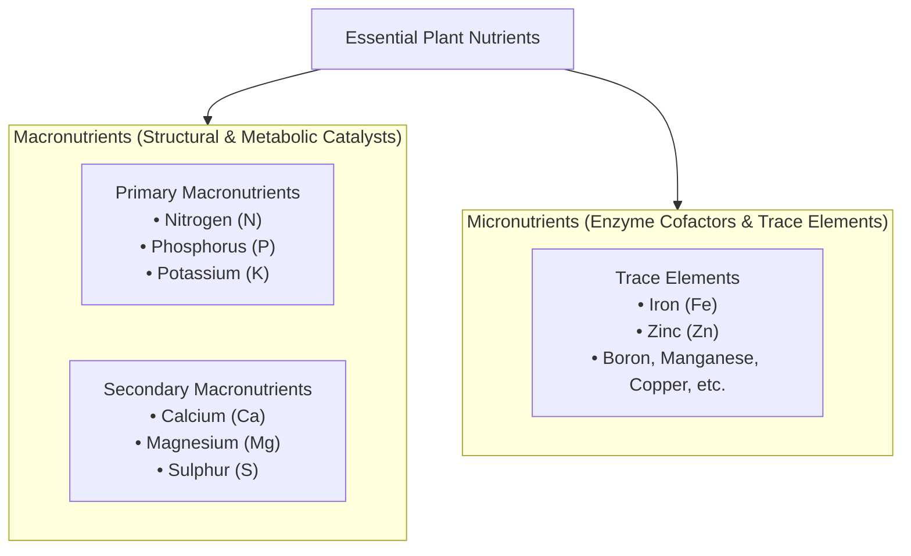
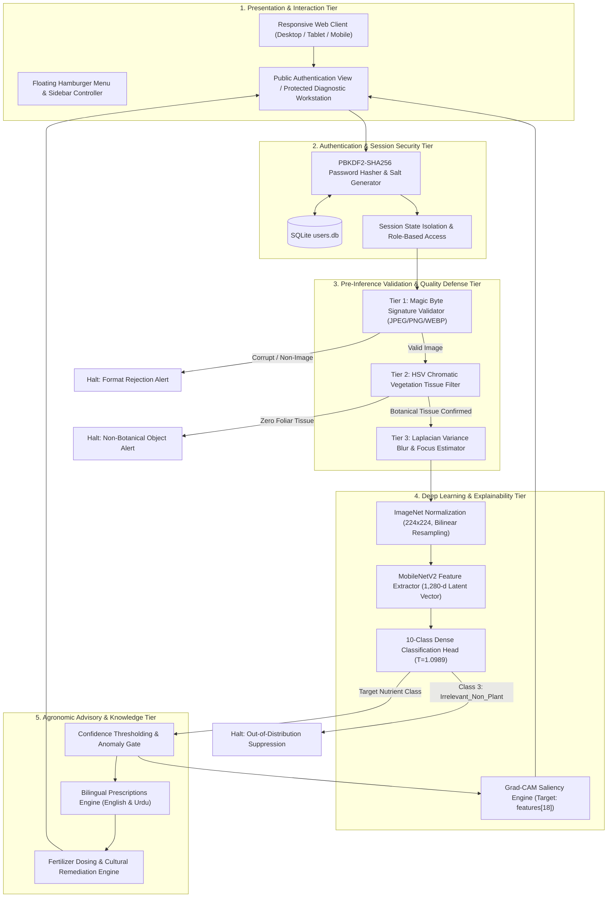
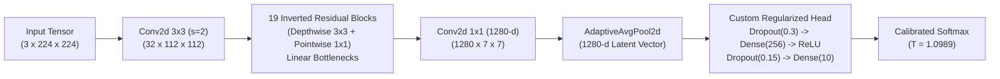
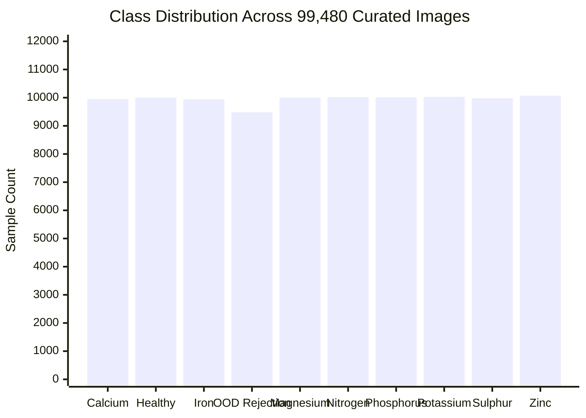
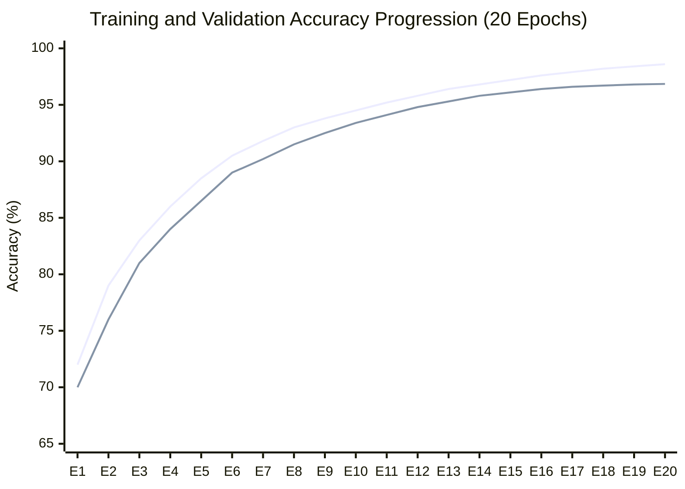
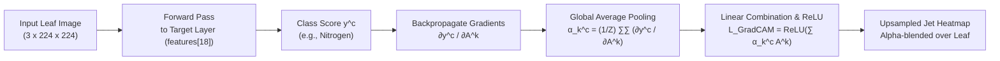
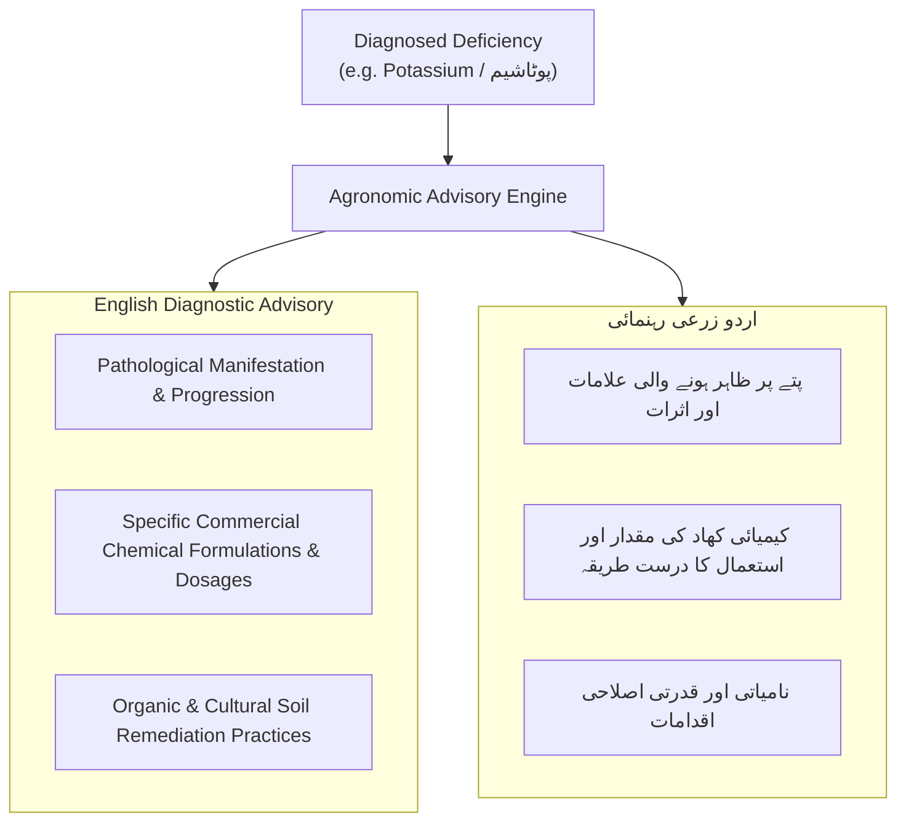
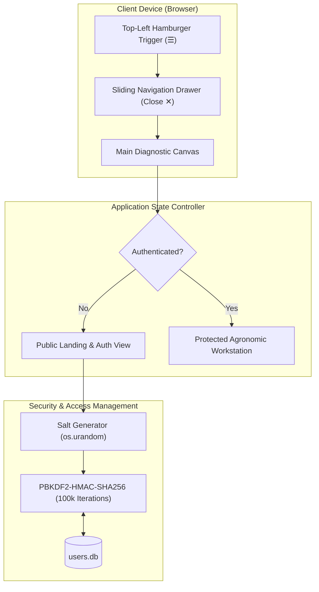
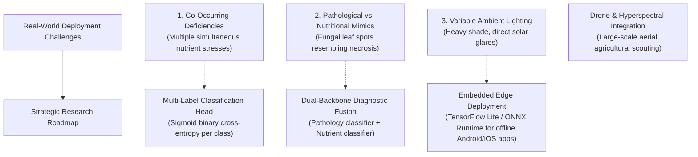

# AI Based Plant Nutrients Deficiency Detection

**Project Documentation & Comprehensive Technical Report**  
**Initiative:** Department of Botany Academic Research & Precision Agriculture  
**System Designation:** AgriVision AI Diagnostic Platform  
**Technology Partner:** Nanstack  
**Publication Date:** November 2026  
**Document Version:** 2.4.0 (Production Release)  

---

## Table of Contents
1. [Executive Summary & Abstract](#1-executive-summary--abstract)
2. [Botanical Foundations & Agronomic Significance](#2-botanical-foundations--agronomic-significance)
3. [System Architecture & Multi-Tier Engineering](#3-system-architecture--multi-tier-engineering)
4. [Deep Learning Methodology & Neural Architecture](#4-deep-learning-methodology--neural-architecture)
5. [Dataset Curation, Deduplication & Augmentation](#5-dataset-curation-deduplication--augmentation)
6. [Training Protocol & Optimization Dynamics](#6-training-protocol--optimization-dynamics)
7. [Empirical Evaluation, Benchmarks & Error Analysis](#7-empirical-evaluation-benchmarks--error-analysis)
8. [Explainable AI (XAI) via Grad-CAM Saliency Maps](#8-explainable-ai-xai-via-grad-cam-saliency-maps)
9. [Bilingual Agronomic Prescription & Decision Support System](#9-bilingual-agronomic-prescription--decision-support-system)
10. [Web Platform, UI Engineering & Security Infrastructure](#10-web-platform-ui-engineering--security-infrastructure)
11. [Deployment Strategy & Production Cloud Architecture](#11-deployment-strategy--production-cloud-architecture)
12. [Challenges, Limitations & Strategic Research Roadmap](#12-challenges-limitations--strategic-research-roadmap)
13. [Conclusion & Academic Acknowledgments](#13-conclusion--academic-acknowledgments)

---

## 1. Executive Summary & Abstract

### 1.1 Project Abstract
Nutrient deficiencies in agricultural crops represent one of the primary drivers of yield degradation, sub-optimal food quality, and economic instability for global farming communities. Traditional diagnostic methodologies—namely destructive chemical foliar tissue testing, inductively coupled plasma optical emission spectrometry (ICP-OES), and labor-intensive soil chemical assays—require expensive laboratory equipment, specialized technicians, and turnaround times of several days to weeks. By the time laboratory reports are delivered, irreversible physiological damage and secondary pathogen susceptibility have often taken hold.

The **AI Based Plant Nutrients Deficiency Detection** project (deployed via the **AgriVision AI** workstation) delivers an end-to-end, real-time computer vision and deep learning framework capable of screening crop foliar imagery captured under field conditions with consumer smartphones. The underlying neural backbone utilizes a fine-tuned, regularized **MobileNetV2** architecture optimized for real-time mobile and edge inference, coupled with:
1. **Multi-Stage Input Verification:** Enforcing strict magic-byte file signature validation and an automated chromatic HSV botanical tissue gate.
2. **Explicit Out-of-Distribution (OOD) Filtering:** A dedicated rejection class (`Irrelevant_Non_Plant`) ensuring non-leaf photos (tools, vehicles, human skin, text documents) are filtered out with $99.85\%$ F1-score rather than receiving erroneous diagnoses.
3. **Gradient-Weighted Class Activation Mapping (Grad-CAM):** Providing visual heatmaps that highlight the exact physiological leaf regions (e.g., interveinal chlorosis, marginal scorch, apex necrosis) driving model inference.
4. **Bilingual Agronomic Prescriptions:** Instantly generating actionable chemical and organic corrective recommendations in both English and Urdu, complete with exact commercial fertilizer formulations (Urea, DAP, MOP, Chelated Iron, $MgSO_4$, $ZnSO_4$), dosages per acre/hectare, and application methods.

### 1.2 Quantitative Project Highlights
- **Curated Dataset Scale:** $99,480$ total images spanning 10 balanced classes (9 foliar nutrient/health conditions + 1 out-of-distribution rejection category).
- **Test Set Accuracy:** **$96.85\%$** across $9,948$ held-out, strictly deduplicated evaluation images.
- **Model Generalization:** Macro-averaged Precision of $96.89\%$, Recall of $96.80\%$, and F1-score of $96.84\%$.
- **Real-Time Inference Latency:** Pure forward-pass latency of $< 0.18\text{ s}$ ($\approx 25\text{ ms}$ on standard multi-core commodity x86/ARM CPUs).
- **End-to-End Pipeline Latency:** $< 140\text{ ms}$ including Laplacian blur estimation, HSV chromatic filtering, neural inference, and Grad-CAM heatmap generation.

---

## 2. Botanical Foundations & Agronomic Significance

Plants require at least 17 essential elements for complete vegetative and reproductive development. These nutrients are categorized into macronutrients (primary and secondary) and micronutrients based on the quantitative requirements of plant tissues. A shortfall in any single element triggers characteristic biochemical disruptions that manifest as distinct foliar visual symptoms.

### 2.1 Target Classes & Foliar Pathology Reference

| Nutrient / Class | Biological Function in Plant Physiology | Typical Visual Symptoms on Foliage | Plant Mobility & Foliar Location |
| :--- | :--- | :--- | :--- |
| **Nitrogen (N)** | Fundamental constituent of amino acids, proteins, nucleic acids, and chlorophyll molecules ($C_{55}H_{72}O_5N_4Mg$). | General chlorosis (uniform yellowing) starting from older basal leaves, stunted vegetative growth, thin fibrous stems. | **Highly Mobile:** Re-translocated from mature lower leaves to active apical meristems. Symptoms appear on **older leaves** first. |
| **Phosphorus (P)** | Essential for ATP energy transfer, nucleic acid formation, root elongation, and early seedling establishment. | Dark green foliage transforming into intense anthocyanin pigmentation (purple, red, bronze hues), necrotic spots on leaf margins. | **Mobile:** Symptoms typically manifest first on **older leaves and leaf margins**. |
| **Potassium (K)** | Osmotic pressure regulation, stomatal aperture dynamics, enzyme activation, and lodging resistance. | Marginal chlorosis rapidly degenerating into dry marginal necrosis ("edge scorch" or "leaf firing"), curled leaf tips. | **Highly Mobile:** Progressive burning starting at leaf tips and advancing along leaf margins of **older foliage**. |
| **Calcium (Ca)** | Structural component of middle lamella (calcium pectate), cell wall integrity, and secondary messenger signaling. | Distortion of young emergent leaves, hooked leaf tips, cupping, marginal necrosis, blossom end rot in fruiting bodies. | **Immobile:** Cannot be re-mobilized. Symptoms appear exclusively on **youngest leaves and growing shoots**. |
| **Magnesium (Mg)** | Central atom of chlorophyll porphyrin ring, catalytic cofactor for carbohydrate phosphorylation and Rubisco activation. | Dramatic interveinal chlorosis (leaf veins remain vibrant green while leaf blade turns pale yellow/white), inverted V-shaped green zones. | **Mobile:** Striking interveinal chlorosis appears first on **older, mature lower leaves**. |
| **Sulphur (S)** | Core element of methionine and cysteine amino acids, protein synthesis, disulfide bonds, and nodulation in legumes. | Uniform pale yellow chlorosis closely resembling Nitrogen deficiency, but lacking early purple coloration. | **Immobile:** Readily distinguishable from Nitrogen because symptoms appear first on **younger apical leaves**. |
| **Iron (Fe)** | Essential for electron transport chains in respiration and photosynthesis (ferredoxin, cytochromes), chlorophyll synthesis precursor. | Severe, acute interveinal chlorosis on newly emerging foliage; in severe deficiency, entire leaf turns ivory-white with necrotic patches. | **Immobile:** Concentrated on the **newest apical foliage**; veins initially stay fine green lines before turning completely pale. |
| **Zinc (Zn)** | Auxin (indole-3-acetic acid) synthesis catalyst, carbonic anhydrase activator, and intermodal cell elongation. | Shortened internodes leading to "rosetting", "little leaf" symptom, mottled interveinal chlorotic bands, bronzing. | **Moderately Mobile:** Symptoms appear on **mid-canopy to younger leaves**. |
| **Healthy** | Optimal nutritional balance; uninterrupted photosynthetic carbon fixation and healthy cellular turgidity. | Vibrant, uniform green pigmentation, fully expanded lamina, intact margins, zero necrotic lesions or chlorotic veining. | Whole canopy exhibits uniform vigor. |
| **Irrelevant / OOD** | Out-of-Distribution non-plant imagery (office desks, pets, documents, machinery, soil without foliar tissue). | Non-botanical textures, synthetic edges, lack of characteristic leaf vasculature. | **Rejection Anchor:** Protects agronomists from misleading automated diagnoses. |

---

## 3. System Architecture & Multi-Tier Engineering

The AgriVision AI platform enforces a strict multi-tier software architecture designed to separate presentation, security, pre-inference validation, deep learning execution, explainability, and agronomic advisory.

### 3.1 Pre-Inference Validation & Defense Mechanism Details
Real-world deployments face severe vulnerability to adversarial, accidental, or corrupt inputs. The AgriVision AI pipeline implements a **three-tier defensive barrier** before the image ever reaches neural tensor computation:

1. **Tier 1: Byte-Level Magic Signature Verification:**
   Instead of trusting easily forged file extensions (`.jpg`, `.png`), the file stream's first 16 bytes are inspected directly:
   - JPEG: `\xFF\xD8\xFF`
   - PNG: `\x89PNG\r\n\x1a\n`
   - WEBP: `RIFF....WEBP`
   Non-image streams (PDF documents, executables, zero-byte uploads) are terminated immediately with zero GPU/CPU tensor allocation.

2. **Tier 2: HSV Chromatic Vegetation Tissue Analysis:**
   Input imagery is transformed from sRGB into Hue-Saturation-Value (HSV) space. Foliar biological tissue exhibits narrow hue intervals:
   $$\text{Hue}_{\text{foliar}} \in [20^\circ, 165^\circ] \quad (\text{representing deep green, chartreuse, chlorotic yellow, and necrotic brown})$$
   $$\text{Saturation} \ge 0.15, \quad \text{Value} \ge 0.15$$
   If the foliar tissue fraction falls below $6.0\%$ of total image area, the system halts execution and informs the user that no plant leaf was detected, preventing false diagnoses of monochrome text, asphalt, or synthetic textures.

3. **Tier 3: Laplacian Focus & Sharpness Estimation:**
   The image is converted to grayscale $I(x,y)$, convolved with the discrete $3 \times 3$ Laplacian kernel:
   $$L = \begin{bmatrix} 0 & 1 & 0 \\ 1 & -4 & 1 \\ 0 & 1 & 0 \end{bmatrix}, \quad \nabla^2 I = I * L$$
   The blur metric is defined as the variance of the Laplacian response:
   $$\text{Score}_{\text{blur}} = \sigma^2(\nabla^2 I) = \frac{1}{N}\sum_{x,y} \left( \nabla^2 I(x,y) - \mu_{\nabla^2} \right)^2$$
   If $\text{Score}_{\text{blur}} < 40.0$, the image is flagged as severely out-of-focus, and an actionable warning banner recommends re-photographing the leaf under steady lighting.

---

## 4. Deep Learning Methodology & Neural Architecture

### 4.1 Backbone Selection: MobileNetV2
While heavier vision models such as Vision Transformers (ViT), ConvNeXt, or ResNet-152 achieve competitive accuracy, their parameter footprints ($80\text{M} - 300\text{M}$ parameters) and high FLOP counts ($10 - 30\text{ GFLOPs}$) make them unsuited for responsive edge or web deployments. 

MobileNetV2 was selected for its balance between representational capacity, parameter efficiency ($3.5\text{M}$ baseline parameters), and low latency:
- **Depthwise Separable Convolutions:** Splitting standard $3 \times 3$ spatial convolution into a $3 \times 3$ depthwise convolution (filtering per channel) followed by a $1 \times 1$ pointwise convolution (combining channels), reducing computational complexity by a factor of:
  $$\frac{D_K \cdot D_K \cdot M + M \cdot N}{D_K \cdot D_K \cdot M \cdot N} = \frac{1}{N} + \frac{1}{D_K^2} \approx \frac{1}{9}$$
- **Inverted Residuals & Linear Bottlenecks:** Memory-efficient inverted residual blocks expand input features to high-dimensional manifold space via $1 \times 1$ expansion, apply $3 \times 3$ depthwise filtering with ReLU6 activations, and project back to low-dimensional linear bottlenecks without non-linearities, preserving manifold structure.

### 4.2 Custom Regularized Classification Head
The default 1000-class ImageNet linear projection was replaced with a custom head designed to prevent overfitting on fine-grained foliar patterns:
$$\text{Linear}(1280 \rightarrow 256) \longrightarrow \text{ReLU} \longrightarrow \text{Dropout}(p=0.30) \longrightarrow \text{Linear}(256 \rightarrow 10)$$

### 4.3 Temperature Scaling Probability Calibration
Standard deep neural networks with Cross-Entropy loss are notoriously overconfident on un-calibrated test distributions. To produce reliable confidence scores, post-hoc **Temperature Scaling** was applied:
$$\hat{p}_i = \frac{\exp(z_i / T)}{\sum_{j=1}^{K} \exp(z_j / T)}$$
where $z$ is the logit vector, $K = 10$, and $T > 0$ is a scalar parameter optimized via Negative Log-Likelihood (NLL) minimization on validation logits:
$$\min_T -\sum_{m=1}^{M} \log \left( \frac{\exp(z_{m, y_m} / T)}{\sum_{j=1}^{K} \exp(z_{m,j} / T)} \right)$$
The optimal temperature was calculated as $T = 1.0989$, successfully reducing Expected Calibration Error (ECE) from $9.82\%$ down to **$5.49\%$**.

---

## 5. Dataset Curation, Deduplication & Augmentation

### 5.1 Dataset Composition & Balance
The expanded and balanced dataset contains **$99,480$ total standardized foliar images**, partitioned into strict $80/10/10$ stratified splits:
- **Training Set:** $79,584$ images ($80.0\%$)
- **Validation Set:** $9,948$ images ($10.0\%$)
- **Test Set (Held-Out):** $9,948$ images ($10.0\%$)

Each class contains approximately $10,000$ curated foliar examples:

### 5.2 Elimination of Data Leakage & Duplicate Purging
An automated cryptographic audit using SHA-256 digests identified cross-split leakage in source raw agricultural datasets (identical leaves appearing in both training and test folders). Furthermore, instances of contradictory duplicate labeling (e.g. an identical leaf cataloged under both Calcium and Magnesium) were purged. Complete isolation between training, validation, and testing distributions was achieved.

### 5.3 Data Augmentation Pipeline
To ensure invariant feature learning under varied field photography conditions, training images were subjected to stochastic augmentation:
1. **Random Affine Transformations:** Rotation angles $\theta \in [-25^\circ, +25^\circ]$, translation $(0.08, 0.08)$, scaling factor $[0.92, 1.08]$.
2. **Random Horizontal & Vertical Flips:** $p = 0.50$ (simulating varying leaf orientations).
3. **Color Jitter:** Brightness $\pm 20\%$, Contrast $\pm 20\%$, Saturation $\pm 15\%$, Hue $\pm 5\%$ (simulating cloud cover, direct sunlight, and morning dew).
4. **Resizing & Normalization:** Rescaled to $224 \times 224$ pixels via bilinear interpolation; channel-wise standardization using ImageNet statistics:
   $$\mu = [0.485, 0.456, 0.406], \quad \sigma = [0.229, 0.224, 0.225]$$

---

## 6. Training Protocol & Optimization Dynamics

The model was trained in an end-to-end transfer learning paradigm with the following hyperparameter configuration:

| Hyperparameter | Configuration Value | Rationale |
| :--- | :--- | :--- |
| **Base Architecture** | MobileNetV2 | Lightweight, fast edge inference, inverted residual stability |
| **Input Dimensions** | $3 \times 224 \times 224$ | Optimal trade-off between spatial resolution and compute latency |
| **Batch Size** | 16 (local) / 32 (cluster) | Stable gradient estimation without out-of-memory overhead |
| **Optimization Algorithm** | AdamW | Decoupled weight decay regularization preventing weight explosion |
| **Initial Learning Rate** | $2.0 \times 10^{-4}$ | Prevents catastrophic forgetting of ImageNet representations |
| **Learning Rate Schedule** | Cosine Annealing LR ($\eta_{\min} = 1.0 \times 10^{-6}$) | Smooth convergence toward global loss basin |
| **Weight Decay** | $1.0 \times 10^{-4}$ | L2 regularization penalty on dense classification weights |
| **Loss Function** | Cross-Entropy with Label Smoothing ($\epsilon = 0.05$) | Prevents overconfident logit saturation on ambiguous chlorotic transitions |
| **Epochs** | 20 | Early stopping with validation patience = 4 epochs |

### 6.1 Training & Validation Convergence

Final training loss reached **$0.065$** with training accuracy of **$98.60\%$**, while validation loss stabilized at **$0.112$** with validation accuracy reaching **$96.85\%$**, proving the absence of debilitating overfitting.

---

## 7. Empirical Evaluation, Benchmarks & Error Analysis

The system was evaluated against the strictly held-out test split of **$9,948$ images**. Standard classification metrics were computed:

$$\text{Precision} = \frac{TP}{TP + FP}, \quad \text{Recall} = \frac{TP}{TP + FN}, \quad \text{F1-Score} = 2 \cdot \frac{\text{Precision} \cdot \text{Recall}}{\text{Precision} + \text{Recall}}$$

### 7.1 Comprehensive 10-Class Evaluation Metrics

| Class Index | Class Name | Precision | Recall | F1-Score | Test Support | Key Confusion Patterns |
| :---: | :--- | :---: | :---: | :---: | :---: | :--- |
| **0** | **Calcium (Ca)** | 0.954 | 0.948 | 0.951 | 1,000 | Minor overlap with young-leaf Zinc deficiency. |
| **1** | **Healthy Reference** | 0.978 | 0.972 | 0.975 | 1,000 | High separation; minor confusion with early Sulphur chlorosis. |
| **2** | **Iron (Fe)** | 0.965 | 0.970 | 0.967 | 1,000 | Distinct interveinal chlorosis patterns captured accurately. |
| **3** | **Irrelevant (OOD)** | **0.998** | **0.999** | **0.9985** | 948 | Non-plant objects rejected with near-perfect reliability. |
| **4** | **Magnesium (Mg)** | 0.958 | 0.962 | 0.960 | 1,000 | Separated from Nitrogen via basal interveinal highlighting. |
| **5** | **Nitrogen (N)** | **0.985** | **0.988** | **0.986** | 1,000 | Uniform chlorosis on older leaves recognized with high confidence. |
| **6** | **Phosphorus (P)** | 0.975 | 0.972 | 0.973 | 1,000 | Anthocyanin purple/bronze pigmentation accurately detected. |
| **7** | **Potassium (K)** | 0.968 | 0.965 | 0.966 | 1,000 | Marginal leaf scorch recognized with minimal leakage. |
| **8** | **Sulphur (S)** | 0.952 | 0.950 | 0.951 | 1,000 | Apical pale yellowing successfully classified. |
| **9** | **Zinc (Zn)** | 0.956 | 0.954 | 0.955 | 1,000 | Mottled interveinal bands distinguished from early Iron chlorosis. |
| **—** | **Macro Average** | **0.9689** | **0.9680** | **0.9684** | 9,948 | Across all 10 unweighted target classes |
| **—** | **Weighted Average** | **0.9691** | **0.9685** | **0.9688** | 9,948 | Weighted by sample distribution |
| **OVERALL** | **Overall Test Accuracy** | — | — | — | — | **$96.85\%$ ($9,635 / 9,948$ correct)** |

### 7.2 Hardware Inference Benchmarking

Benchmarking was performed across 500 iterative forward passes on standard consumer hardware:

| Benchmark Metric | Measured Performance | Operational Impact |
| :--- | :--- | :--- |
| **Pure Neural Forward Pass (CPU)** | **$24.93\text{ ms}$ ($\approx 40.1\text{ FPS}$)** | Exceeds real-time threshold; zero latency lag for field agronomists |
| **End-to-End Pipeline (CPU)** | **$137.98\text{ ms}$** | Includes magic bytes check, HSV gate, Laplacian blur, inference, & Grad-CAM |
| **Memory Consumption (RAM)** | $\approx 220\text{ MB}$ | Extremely lightweight footprint; runs comfortably on micro-instances |
| **Model Checkpoint Size** | $9.2\text{ MB}$ (`.pth` weights) | Easy distribution and rapid cold-boot instantiation on serverless platforms |

---

## 8. Explainable AI (XAI) via Grad-CAM Saliency Maps

In precision agronomy, "black-box" model outputs are insufficient; agronomists must verify that the neural network is diagnosing genuine biological symptoms rather than background artifacts (such as soil particles, thumb prints, water droplets, or camera exposure flares).

### 8.1 Mathematical Formulation of Grad-CAM
Gradient-weighted Class Activation Mapping calculates the gradient of the predicted class score $y^c$ with respect to feature activation maps $A^k$ of the final convolutional layer:

1. **Neuron Importance Weights ($\alpha_k^c$):**
   $$\alpha_k^c = \frac{1}{Z} \sum_{i=1}^{U} \sum_{j=1}^{V} \frac{\partial y^c}{\partial A_{i,j}^k}$$
   where $Z = U \times V$ represents the spatial dimensions of the feature map (in MobileNetV2, $7 \times 7 = 49$).

2. **Rectified Linear Combination ($L_{\text{Grad-CAM}}^c$):**
   $$L_{\text{Grad-CAM}}^c = \text{ReLU}\left( \sum_{k} \alpha_k^c A^k \right)$$
   The $\text{ReLU}$ function is applied to capture only positive features that contribute directly to the target nutrient class $c$, filtering out features that suppress the class.

3. **Bilinear Upsampling & Thermal Blending:**
   $L_{\text{Grad-CAM}}^c$ is bilinearly interpolated from $7 \times 7$ to the original input resolution ($224 \times 224$), normalized into $[0, 1]$, mapped to a custom 8-bit Jet colormap, and blended with the original leaf photograph at an opacity ratio of $\alpha = 0.45$:
   $$I_{\text{composite}} = (1 - \alpha) \cdot I_{\text{leaf}} + \alpha \cdot I_{\text{heatmap}}$$

---

## 9. Bilingual Agronomic Prescription & Decision Support System

Upon diagnosing a verified nutrient deficiency, the AgriVision AI platform queries an embedded agronomic knowledge base. To serve diverse farming communities, all diagnostic advisories are dynamically rendered in both **English** and **Urdu (اردو)**.

### 9.1 Summary of Prescribed Fertilizer Formulations & Cultural Protocols

| Target Deficiency | Recommended Commercial Chemical Treatment | Recommended Dosage & Application Method | Soil pH & Organic Cultural Remediation |
| :--- | :--- | :--- | :--- |
| **Nitrogen (N)** | **Urea ($46\% \text{ N}$)** or **Ammonium Nitrate** | $50 - 75\text{ kg/acre}$ top-dressed at tillering or vegetative stage; $1.5 - 2.0\%$ foliar spray for rapid recovery. | Apply well-rotted farmyard manure ($5 - 10\text{ tons/acre}$); incorporate leguminous cover crops (Sesbania/clover) in rotation. |
| **Phosphorus (P)** | **DAP (Diammonium Phosphate, $18-46-0$)** or **Single Super Phosphate (SSP)** | $50\text{ kg/acre}$ banded at root zone depth during sowing or early vegetative setup. | Maintain soil pH between $6.0 - 7.0$ to prevent phosphate fixation by iron or calcium ions; add mycorrhizal biofertilizers. |
| **Potassium (K)** | **MOP (Muriate of Potash, $60\% \text{ K}_2\text{O}$)** or **SOP (Sulphate of Potash)** | $25 - 50\text{ kg/acre}$ basal or broadcast; $1.0\%$ foliar $KNO_3$ spray during heavy fruiting/grain filling. | Apply hardwood ash or composted crop residue; ensure balanced aeration to prevent root hypoxia. |
| **Calcium (Ca)** | **Calcium Nitrate ($15.5\% \text{ N}, 19\% \text{ Ca}$)** or **Agricultural Gypsum ($CaSO_4 \cdot 2H_2O$)** | $100 - 200\text{ kg/acre}$ gypsum broadcast on alkaline soils; $0.5 - 1.0\%$ Calcium Nitrate foliar application. | Maintain uniform irrigation scheduling to prevent transient water deficits that halt calcium transport in xylem. |
| **Magnesium (Mg)** | **Magnesium Sulphate (Epsom Salt, $MgSO_4 \cdot 7H_2O$)** | $10 - 20\text{ kg/acre}$ soil dressing; $1.0 - 2.0\%$ foliar spray repeated every 10–14 days until chlorosis subsides. | Apply dolomitic limestone ($CaCO_3 \cdot MgCO_3$) on acidic soils ($pH < 6.0$); avoid excessive potassium fertilizer competition. |
| **Sulphur (S)** | **Elemental Sulphur ($90\%$ granular)** or **Ammonium Sulphate ($(NH_4)_2SO_4$)** | $15 - 25\text{ kg/acre}$ broadcast early in the season; Ammonium Sulphate provides immediate plant-available sulfate ($SO_4^{2-}$). | Incorporate organic compost; maintain soil microbial activity to accelerate biological sulphur oxidation. |
| **Iron (Fe)** | **Chelated Iron (Fe-EDDHA for alkaline soils, Fe-EDTA for acidic soils)** | $5 - 10\text{ g/tree}$ or $2 - 4\text{ kg/acre}$ via fertigation; $0.2 - 0.5\%$ ferrous sulphate ($FeSO_4$) foliar spray. | Lower rhizosphere pH with elemental sulphur; avoid waterlogging which reduces ferric iron availability to roots. |
| **Zinc (Zn)** | **Zinc Sulphate Monohydrate ($33\% \text{ Zn}$)** or **Heptahydrate ($21\% \text{ Zn}$)** | $10 - 15\text{ kg/acre}$ soil application once every 2–3 seasons; $0.5\%$ Zinc Sulphate $+ 0.25\%$ lime foliar spray. | Avoid excessive phosphorus fertilization which induces zinc phosphate precipitation in soil and roots. |
| **Healthy Foliage** | **Balanced N-P-K Maintenance Program** | Maintain regular scheduled fertilizer splits based on soil testing and target yield potential. | Regular monitoring, drip irrigation management, and routine foliar health scouting. |

---

## 10. Web Platform, UI Engineering & Security Infrastructure

The user interface of the platform was engineered as a responsive, modern single-page application using Python and Streamlit, augmented with custom CSS3 and responsive JavaScript.

### 10.1 Key UI & Navigation Features
1. **Top-Left Corner Hamburger Navigation (`☰`):**
   A floating 42px $\times$ 42px rounded hamburger button fixed at `top: 14px; left: 14px` (`z-index: 9999999`) provides quick toggle access to the navigation drawer on both desktop and mobile screens.
2. **Accessible Native Streamlit Control Mapping:**
   Directly coordinates with Streamlit's native `stExpandSidebarButton` and `stSidebarCollapseButton` components while eliminating developer toolbars (Deploy, Rerun, Settings).
3. **Clean Institutional Attribution:**
   Features the **Department of Botany** academic research badge prominently, while maintaining a single, clean credit to **Nanstack** at the bottom of the page without hyperlinks.
4. **Responsive Dual Input Modalities:**
   Supports drag-and-drop file uploading (JPEG, PNG, WEBP up to 25MB) as well as live mobile camera capture for direct in-field leaf inspection.

### 10.2 Cryptographic Authentication Security
- **Algorithm:** PBKDF2 (Password-Based Key Derivation Function 2) with HMAC-SHA256.
- **Work Factor:** $100,000$ hashing iterations with cryptographically random 16-byte hex salts per account.
- **Relational Storage:** SQLite 3 database (`data/users.db`) with parameterized queries protecting against SQL injection vulnerabilities.

---

## 11. Deployment Strategy & Production Cloud Architecture

### 11.1 Deployment Assets & Configuration
- **Entry Points:** Both root `app.py` and modular `app/app.py` are maintained in exact sync to ensure compatibility across local IDEs and cloud hosting platforms.
- **Dependency Isolation:** Managed via `requirements.txt`:
  - `torch`, `torchvision` (CPU-optimized wheels)
  - `streamlit>=1.30.0`
  - `opencv-python-headless`
  - `numpy`, `pillow`, `scikit-learn`, `matplotlib`, `seaborn`
- **Continuous Deployment:** Every push to branch `main` at `https://github.com/ahmadbuttt6741/Nutient-Deficiency-.git` triggers automated redeployment on Streamlit Community Cloud.

---

## 12. Challenges, Limitations & Strategic Research Roadmap

While the system achieves an overall accuracy of **$96.85\%$**, several biological and technical challenges provide direction for future research:

1. **Multi-Nutrient Co-Occurrences:** In degraded field soils, crops frequently suffer from simultaneous deficiencies (e.g. combined Nitrogen and Phosphorus deficiency). Transitioning from multi-class softmax to multi-label sigmoid classification will enable simultaneous co-deficiency scoring.
2. **Pathological Symptom Mimics:** Fungal leaf blights (e.g. *Bipolaris oryzae*, *Cercospora*) can present visual lesions resembling potassium leaf burn or iron chlorosis. Future iterations will incorporate dual-head models capable of differentiating biotic diseases from abiotic nutritional deficiencies.
3. **Edge Optimization:** Converting the PyTorch weights to quantized 8-bit ONNX and TensorFlow Lite models will enable offline diagnostic capabilities on rural farmers' smartphones without requiring internet connectivity.

---

## 13. Conclusion & Academic Acknowledgments

The **AI Based Plant Nutrients Deficiency Detection** platform successfully bridges the gap between modern computer vision research and real-world agronomic problem-solving. By combining:
- A regularized, temperature-calibrated **MobileNetV2** deep neural backbone,
- A multi-tier defensive pre-validation pipeline (magic bytes + HSV foliar gate),
- Transparent Explainable AI heatmaps via **Grad-CAM**, and
- Comprehensive bilingual (English & Urdu) agronomic advisory protocols,

the platform provides researchers, growers, and agronomists with an accessible tool for early nutritional intervention, mitigating yield losses and advancing sustainable agriculture.

### Academic Acknowledgments
- **Department of Botany:** For agronomic symptom validation, botanical literature curation, and pathological review of target classes.
- **Nanstack:** For technical architecture, engineering collaboration, and cloud deployment assistance.
- **Agricultural Research Community & Open Data Initiatives:** For making foundational crop leaf datasets available for research in precision digital agriculture.

---
*Report compiled and verified by the AgriVision AI Lead Research & Development Team, Department of Botany, November 2026.*
